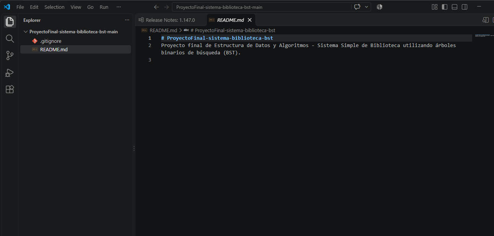
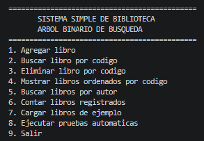
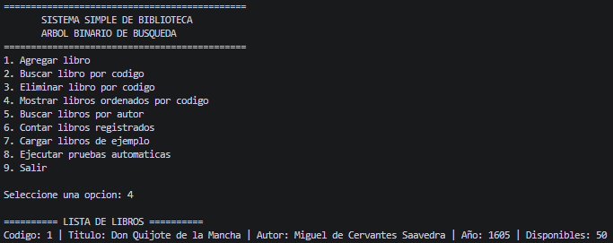

# ProyectoFinal-sistema-biblioteca-bst
Proyecto final de Estructura de Datos y Algoritmos - Sistema Simple de Biblioteca utilizando árboles binarios de búsqueda (BST).
# Sistema Simple de Biblioteca con Árbol Binario de Búsqueda (BST)

**Curso:** Estructura de Datos y Algoritmos – Tecsup
**Sección:** A
**Grupo:** 3
**Integrantes:**
- Susana Garcia Titto
- Angela Inocente Espíritu

**Ejercicio**: Batería 2 – Ejercicio 2: Sistema Simple de Biblioteca

## 1. Introducción al problema

Una biblioteca escolar gestiona su colección de libros en cuadernos. Esto hace
difícil encontrar un libro rápidamente y saber cuáles están disponibles, porque
hay que revisar los registros uno por uno.

Para resolverlo se desarrolló un sistema en Python que permite:

- **Gestionar los libros:** agregar, buscar y eliminar un libro por su código.
- **Hacer consultas básicas:** mostrar todos los libros ordenados por código,
  buscar los libros de un autor y contar el total de libros.

Cada libro tiene un **código único**, un título, un autor, un año y una cantidad
disponible. Los libros se guardan en un **árbol binario de búsqueda (BST)**
implementado desde cero, sin librerías externas.


## 2. Estructura de datos elegida: Árbol Binario de Búsqueda (BST)

### ¿Qué es?

Un árbol binario de búsqueda (BST) es un árbol donde cada nodo tiene como
máximo dos hijos y cumple estas propiedades:

- El subárbol **izquierdo** de un nodo contiene solo claves **menores** que la
  del nodo.
- El subárbol **derecho** de un nodo contiene solo claves **mayores** que la
  del nodo.
- Tanto el subárbol izquierdo como el derecho son también árboles de búsqueda
  binaria.

### ¿Por qué se eligió?

En un árbol binario común, para buscar un elemento hay que revisar tanto el
subárbol izquierdo como el derecho, por lo que en el peor caso se recorre todo
el árbol (O(n)). En un BST, en cada comparación se descarta una parte del
árbol, lo que hace más rápido insertar, buscar y eliminar libros.

Además, el recorrido **inorder** de un BST devuelve los elementos ordenados,
lo que permite mostrar los libros ordenados por código sin ordenar nada
aparte.

### ¿Cómo se usa en este proyecto?

- La **clave** del árbol es el **código único** del libro.
- Cada nodo (`BSTNode`) guarda un objeto `Libro` en `data`.
- Si un código es menor que el del nodo actual, el libro va a la izquierda; si
  es mayor, va a la derecha. No se permiten códigos repetidos.

### Código de la estructura

Clase que representa un libro:

```python
class Libro:
    def __init__(self, codigo, titulo, autor, anio, cantidad):
        self.codigo = codigo
        self.titulo = titulo
        self.autor = autor
        self.anio = anio
        self.cantidad = cantidad
```

Nodo del árbol:

```python
class BSTNode:
    def __init__(self, data):
        self.left = None     # subárbol izquierdo: códigos menores
        self.right = None    # subárbol derecho: códigos mayores
        self.data = data     # objeto Libro
```

Inserción de un libro (recursiva):

```python
def insertNode(root, node):
    if root is None:
        return node

    if root.data.codigo > node.data.codigo:
        root.left = insertNode(root.left, node)
    elif root.data.codigo < node.data.codigo:
        root.right = insertNode(root.right, node)

    return root
```

Búsqueda de un libro por código (recursiva):

```python
def find(root, codigo):
    currentNode = root
    if currentNode == None:
        return None
    else:
        if codigo == currentNode.data.codigo:
            return currentNode
        if codigo < currentNode.data.codigo:
            return find(currentNode.left, codigo)
        else:
            return find(currentNode.right, codigo)
```
---

## 3. Operaciones implementadas

| Operación | Función | Descripción |
|---|---|---|
| Agregar libro | `insertNode` | Inserta un libro según su código. Antes de insertar, el menú verifica con `find` que el código no exista. |
| Buscar por código | `find` | Compara el código con el nodo actual y sigue por la izquierda o por la derecha hasta encontrarlo. |
| Eliminar por código | `delete` | Elimina el nodo según sus hijos (hoja, un hijo o dos hijos). |
| Mostrar libros ordenados | `inOrderTraversal` | Recorrido inorder: izquierda, nodo, derecha. Imprime los libros ordenados por código. |
| Buscar por autor | `findByAuthor` | Recorre todo el árbol y filtra los libros del autor, sin distinguir mayúsculas. |
| Contar libros | `countBooks` | Cuenta todos los nodos del árbol. |

### Eliminar un libro (`delete`)

Primero se busca el nodo con el código indicado. Al encontrarlo, hay tres casos:

1. **Hoja (sin hijos):** se quita el nodo directamente.
2. **Un hijo:** el hijo ocupa el lugar del nodo eliminado.
3. **Dos hijos:** se reemplaza el libro del nodo por el de su **sucesor
   inorder** (el menor del subárbol derecho, obtenido con `findMin`) y luego se
   elimina ese sucesor.

```python
def findMin(root):
    currentNode = root
    while currentNode.left is not None:
        currentNode = currentNode.left
    return currentNode


def delete(root, codigo):
    if root is None:
        return None

    if codigo < root.data.codigo:
        root.left = delete(root.left, codigo)
    elif codigo > root.data.codigo:
        root.right = delete(root.right, codigo)
    else:
        # Casos 1 y 2: sin hijo izquierdo o sin hijo derecho
        if root.left is None:
            return root.right
        if root.right is None:
            return root.left

        # Caso 3: dos hijos, sucesor in-order
        successor = findMin(root.right)
        root.data = successor.data
        root.right = delete(root.right, successor.data.codigo)

    return root
```

### Mostrar libros ordenados (`inOrderTraversal`)

```python
def inOrderTraversal(root):
    if not root:
        return
    inOrderTraversal(root.left)
    print(root.data)
    inOrderTraversal(root.right)
```

### Buscar por autor y contar libros

El árbol está ordenado por código y no por autor, por eso `findByAuthor`
necesita revisar todos los libros.

```python
def findByAuthor(root, autor):
    result = []
    for libro in inOrderList(root):
        if libro.autor.lower() == autor.lower():
            result.append(libro)
    return result


def countBooks(root):
    if root is None:
        return 0
    return 1 + countBooks(root.left) + countBooks(root.right)
```

---

## 5. Capturas de pantalla

### Pruebas automáticas


### Menú principal


### Agregar libros


### Mostrar libros ordenados por código (inorder)


### Buscar por código y por autor


### Eliminar un libro
