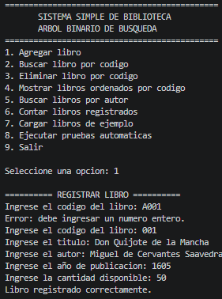
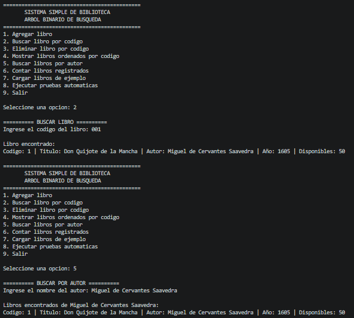
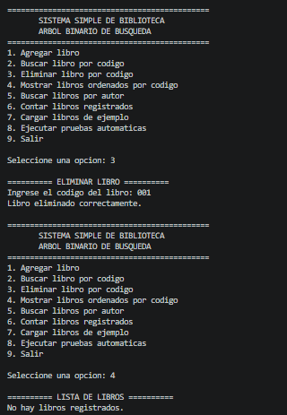

# Sistema Simple de Biblioteca con Árbol Binario de Búsqueda (BST)

**Curso:** Estructura de Datos y Algoritmos – Tecsup
**Sección:** A
**Grupo:** 3

**Integrantes:**
- Susana Garcia Titto
- Angela Inocente Espíritu

**Ejercicio:** Batería 2 – Ejercicio 2: Sistema Simple de Biblioteca

---

## 1. Introducción al problema

Una biblioteca escolar gestiona su colección de libros en cuadernos. Esto hace
difícil encontrar un libro rápidamente y saber cuáles están disponibles, porque
hay que revisar los registros uno por uno.

Para resolverlo se desarrolló un sistema en Python que permite:

- **Gestionar los libros:** agregar, buscar y eliminar un libro por su código.
- **Hacer consultas básicas:** mostrar todos los libros ordenados por código,
  buscar los libros de un autor y contar el total de libros.

Cada libro tiene un **código único**, un título, un autor, un año y una cantidad
disponible. Los libros se guardan en un **árbol binario de búsqueda (BST)**
implementado desde cero, sin librerías externas.

---

## 2. Estructura de datos elegida: Árbol Binario de Búsqueda (BST)

### ¿Qué es?

Un árbol binario de búsqueda (BST) es un árbol donde cada nodo tiene como
máximo dos hijos y cumple estas propiedades:

- El subárbol **izquierdo** contiene solo claves **menores** que la del nodo.
- El subárbol **derecho** contiene solo claves **mayores** que la del nodo.
- Ambos subárboles también son árboles de búsqueda binaria.

### ¿Por qué se eligió?

En un árbol común, buscar un elemento puede obligar a revisar todos los nodos.
En un BST, cada comparación descarta una parte del árbol, lo que hace más
rápido agregar, buscar y eliminar libros.

Además, el recorrido **inorder** de un BST devuelve los elementos ordenados,
por lo que se pueden mostrar los libros ordenados por código sin ordenar nada
aparte.

### ¿Cómo se usa en este proyecto?

- La **clave** del árbol es el **código único** del libro.
- Cada nodo (`Nodo`) guarda un objeto `Libro`.
- Si un código es menor que el del nodo actual, el libro va a la izquierda; si
  es mayor, va a la derecha. **No se permiten códigos repetidos.**

### Diseño de clases

| Clase | Atributos | Función |
|---|---|---|
| `Libro` | `codigo`, `titulo`, `autor`, `año`, `cantidad_disponible` | Representa un libro de la biblioteca |
| `Nodo` | `libro`, `izquierdo`, `derecho` | Nodo del árbol |
| `ArbolBinarioBusqueda` | `raiz` | Contiene las operaciones del BST |

### Código de la estructura

```python
class Libro:
    def __init__(self, codigo, titulo, autor, año, cantidad_disponible):
        self.codigo = codigo
        self.titulo = titulo
        self.autor = autor
        self.año = año
        self.cantidad_disponible = cantidad_disponible


class Nodo:
    def __init__(self, libro):
        self.libro = libro
        self.izquierdo = None
        self.derecho = None


class ArbolBinarioBusqueda:
    def __init__(self):
        # Al inicio, el árbol está vacío
        self.raiz = None
```

Inserción de un libro:

```python
def insertar(self, libro):
    if self.raiz is None:
        self.raiz = Nodo(libro)
        return True
    return self._insertar_recursivo(self.raiz, libro)

def _insertar_recursivo(self, nodo_actual, libro):
    if libro.codigo < nodo_actual.libro.codigo:
        if nodo_actual.izquierdo is None:
            nodo_actual.izquierdo = Nodo(libro)
            return True
        return self._insertar_recursivo(nodo_actual.izquierdo, libro)

    elif libro.codigo > nodo_actual.libro.codigo:
        if nodo_actual.derecho is None:
            nodo_actual.derecho = Nodo(libro)
            return True
        return self._insertar_recursivo(nodo_actual.derecho, libro)

    else:
        return False  # código duplicado
```

Búsqueda de un libro por código:

```python
def buscar(self, codigo):
    return self._buscar_recursivo(self.raiz, codigo)

def _buscar_recursivo(self, nodo_actual, codigo):
    if nodo_actual is None:
        return None
    if codigo == nodo_actual.libro.codigo:
        return nodo_actual.libro
    elif codigo < nodo_actual.libro.codigo:
        return self._buscar_recursivo(nodo_actual.izquierdo, codigo)
    else:
        return self._buscar_recursivo(nodo_actual.derecho, codigo)
```

---

## 3. Operaciones implementadas

Las operaciones del árbol están en la clase `ArbolBinarioBusqueda`. Las
funciones de `operaciones.py` piden los datos al usuario, llaman a esos métodos
y muestran los resultados en pantalla.

| Operación | Método del árbol | Descripción |
|---|---|---|
| Agregar libro | `insertar` | Inserta un libro según su código. Si el código ya existe, no lo inserta y devuelve `False`. |
| Buscar por código | `buscar` | Compara el código con el nodo actual y sigue por la izquierda o por la derecha hasta encontrarlo. |
| Eliminar por código | `eliminar` | Elimina el nodo según sus hijos (hoja, un hijo o dos hijos). |
| Mostrar libros ordenados | `inorder` | Recorrido inorder: izquierda, nodo, derecha. Devuelve una lista ordenada por código. |
| Buscar por autor | `buscar_por_autor` | Recorre todo el árbol y filtra los libros del autor, sin distinguir mayúsculas. |
| Contar libros | `contar_libros` | Cuenta los nodos del árbol (registros, no ejemplares). |

### Eliminar un libro (`eliminar`)

Primero se verifica que el libro exista. Luego se busca el nodo y, al
encontrarlo, hay tres casos:

1. **Hoja (sin hijos):** se quita el nodo directamente.
2. **Un hijo:** el hijo ocupa el lugar del nodo eliminado.
3. **Dos hijos:** se reemplaza el libro del nodo por el de su **sucesor
   inorden** (el menor del subárbol derecho) y luego se elimina ese sucesor.

```python
def eliminar(self, codigo):
    if self.buscar(codigo) is None:
        return False
    self.raiz = self._eliminar_recursivo(self.raiz, codigo)
    return True

def _eliminar_recursivo(self, nodo_actual, codigo):
    if nodo_actual is None:
        return None

    if codigo < nodo_actual.libro.codigo:
        nodo_actual.izquierdo = self._eliminar_recursivo(
            nodo_actual.izquierdo, codigo
        )
    elif codigo > nodo_actual.libro.codigo:
        nodo_actual.derecho = self._eliminar_recursivo(
            nodo_actual.derecho, codigo
        )
    else:
        # Caso 1: el nodo no tiene hijos
        if nodo_actual.izquierdo is None and nodo_actual.derecho is None:
            return None
        # Caso 2: solo tiene hijo derecho
        elif nodo_actual.izquierdo is None:
            return nodo_actual.derecho
        # Caso 2: solo tiene hijo izquierdo
        elif nodo_actual.derecho is None:
            return nodo_actual.izquierdo
        # Caso 3: tiene dos hijos
        else:
            sucesor = self._buscar_minimo(nodo_actual.derecho)
            nodo_actual.libro = sucesor.libro
            nodo_actual.derecho = self._eliminar_recursivo(
                nodo_actual.derecho, sucesor.libro.codigo
            )

    return nodo_actual

def _buscar_minimo(self, nodo):
    actual = nodo
    while actual.izquierdo is not None:
        actual = actual.izquierdo
    return actual
```

### Mostrar libros ordenados (`inorder`)

```python
def inorder(self):
    libros = []
    self._inorder_recursivo(self.raiz, libros)
    return libros

def _inorder_recursivo(self, nodo_actual, libros):
    if nodo_actual is None:
        return
    self._inorder_recursivo(nodo_actual.izquierdo, libros)
    libros.append(nodo_actual.libro)
    self._inorder_recursivo(nodo_actual.derecho, libros)
```

### Buscar por autor y contar libros

El árbol está ordenado por código y no por autor, por eso la búsqueda por
autor necesita revisar todos los nodos.

```python
def buscar_por_autor(self, autor):
    encontrados = []
    self._buscar_autor_recursivo(self.raiz, autor, encontrados)
    return encontrados

def _buscar_autor_recursivo(self, nodo_actual, autor, encontrados):
    if nodo_actual is None:
        return
    if nodo_actual.libro.autor.lower() == autor.lower():
        encontrados.append(nodo_actual.libro)
    self._buscar_autor_recursivo(nodo_actual.izquierdo, autor, encontrados)
    self._buscar_autor_recursivo(nodo_actual.derecho, autor, encontrados)

def contar_libros(self):
    return self._contar_recursivo(self.raiz)

def _contar_recursivo(self, nodo_actual):
    if nodo_actual is None:
        return 0
    return (
        1
        + self._contar_recursivo(nodo_actual.izquierdo)
        + self._contar_recursivo(nodo_actual.derecho)
    )
```

### Menú interactivo

El programa muestra un menú con 9 opciones:

| Opción | Acción |
|---|---|
| 1 | Agregar libro |
| 2 | Buscar libro por código |
| 3 | Eliminar libro por código |
| 4 | Mostrar libros ordenados por código |
| 5 | Buscar libros por autor |
| 6 | Contar libros registrados |
| 7 | Cargar libros de ejemplo |
| 8 | Ejecutar pruebas automáticas |
| 9 | Salir |

### Pruebas automáticas

La opción 8 ejecuta 7 pruebas con `assert` sobre un árbol independiente, para
no modificar los libros que el usuario registró: contar libros, buscar un
código existente y uno inexistente, recorrido inorder, búsqueda por autor,
eliminación y rechazo de códigos duplicados.

### Archivos del proyecto y ejecución

| Archivo | Contenido |
|---|---|
| `biblioteca.py` | Menú principal y pruebas automáticas |
| `estructuras.py` | Clases `Libro`, `Nodo` y `ArbolBinarioBusqueda` |
| `operaciones.py` | Funciones que interactúan con el usuario |

Requiere Python 3. Para ejecutar el programa:

```bash
python biblioteca.py
```

---

## 4. Análisis de complejidad (Big O)

Sea **n** la cantidad de libros y **h** la altura del árbol. Insertar, buscar
y eliminar recorren como máximo un camino desde la raíz hasta una hoja, por lo
que su costo depende de **h**.

| Operación | Método | Caso promedio (árbol balanceado) | Peor caso (árbol desbalanceado) |
|---|---|---|---|
| Agregar libro | `insertar` | O(log n) | O(n) |
| Buscar por código | `buscar` | O(log n) | O(n) |
| Eliminar por código | `eliminar` | O(log n) | O(n) |
| Mostrar ordenados | `inorder` | O(n) | O(n) |
| Buscar por autor | `buscar_por_autor` | O(n) | O(n) |
| Contar libros | `contar_libros` | O(n) | O(n) |

- **Caso promedio:** si el árbol está balanceado, h ≈ log n, y cada
  comparación descarta aproximadamente la mitad de los libros.
- **Peor caso:** si los códigos se agregan ya ordenados (por ejemplo 10, 20, 30,
  40...), el árbol queda como una lista y h = n.
- **`eliminar`** primero llama a `buscar` y luego recorre el árbol para
  eliminar el nodo, por lo que sigue siendo O(h).
- **`inorder`, `buscar_por_autor` y `contar_libros`** visitan todos los nodos
  una vez, por eso son O(n) siempre. La búsqueda por autor no puede aprovechar
  el orden del árbol porque este se ordena por código.
- **Memoria:** el uso de memoria es O(n) por los nodos, y las llamadas
  recursivas usan O(h) adicional.

---

## 5. Capturas de pantalla

### Pruebas automáticas (opción 8)


### Menú principal


### Agregar libros


### Mostrar libros ordenados por código (inorder)


### Buscar por código y por autor


### Eliminar un libro


---

## 6. Conclusiones

- El árbol binario de búsqueda permitió agregar y buscar libros por código
  comparando solo un camino del árbol, y mantiene los libros ordenados gracias
  al recorrido inorder.
- La eliminación fue la operación más compleja, porque hay que tratar tres
  casos: nodo hoja, nodo con un hijo y nodo con dos hijos.
- La búsqueda por autor y el conteo recorren todo el árbol, ya que el BST está
  ordenado solo por código.
- Si los códigos se insertan en orden, el árbol se desbalancea y el
  rendimiento baja a O(n). Un árbol AVL podría resolverlo en una futura
  versión.
- Separar el código en clases y funciones, y agregar pruebas automáticas,
  ayudó a comprobar que cada operación funciona correctamente.
- Implementar la estructura desde cero ayudó al equipo a entender la
  recursividad y cómo se enlazan los nodos.